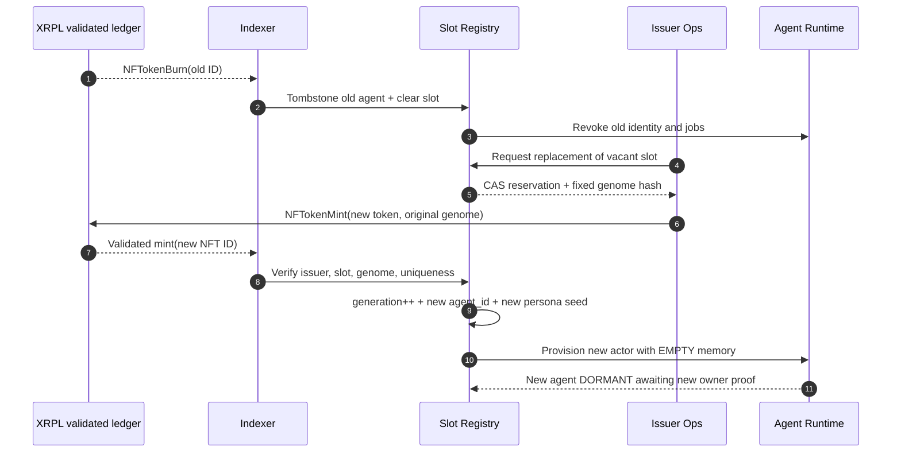

# RFC-007 · The Rebirth Protocol: Immutable Genome, Ephemeral Consciousness

> **Same DNA. Different character. One finite civilization of 1,111 concurrent positions.**

## Design thesis

In Genesis, **genetic identity is preserved by the slot**, while **personal identity belongs to the individual NFT generation**. A burn is an irreversible death of a specific agent; a team-authorized remint is an independent issuance of a successor agent with **exactly the same base attributes** but with a **fresh personality and life**. There is no import of the deceased agent's latent memory, reputation, friendships, prompt history or owner credentials.

The protocol names this *generational succession*, not resurrection. The source of truth is validated XRPL provenance; the agent system runs off-chain.

## Immutable slot DNA vs new-generation persona

**Slot-static genome** (`slot_id`, `genome_version`, `genome_hash`): visual traits, art/appearance specification, archetype, attribute scores, base skills and fixed ability affinities. For all generations of the same slot, canonical JSON normalizes identically and the commitment hash matches. The first minted generation establishes an immutable hash in a signed, append-only collection registry.

**Instance-specific identity** (`generation`, `nftoken_id`, `agent_id`, `persona_seed_commitment`): personality profile, style, social behavior, personal goals, public history, mission output, preferences shaped by experience. Persona seeding uses audited cryptographically secure entropy after successful new mint, bound to unique `agent_id` and generation with domain separation. A hash commitment avoids opaque administrator rerolls. Identity keys and private memory are regenerated, never copied.

The same archetype and cognitive statistics are *constraints*; they do not force clones. Two generations may both be 'Guardian' with identical curiosity and caution yet adopt different interpersonal relationships, ambitions and speech patterns.

## Mint / burn / remint lifecycle



### Transactionality / anti-double-issue controls

- Registry `slot_id` is unique; partial unique index enforces `one living agent per slot` and `UNIQUE(slot_id,generation)`.
- A reissue intent references **exactly one validated burn**, an approved issuer, a signed and versioned slot-genome commitment, and a monotonic generation number.
- Under `SERIALIZABLE` isolation, reserve the vacant slot with a nonce and single-use authorization. Sign and submit mint once; on network timeout query the chain for the submitted transaction before retrying.
- Validate actual mint metadata and derived NFT ID, then admit the token to the current roster. Do not treat a response from a mint API as finality.
- Reissued NFTs may need marketplace or metadata/indexer support to appear in the same visible collection; this must be proven with the canonical issuer/taxon, not assumed.
- An app-level 1,111 active cap is not an XRPL native hard-cap guarantee; issuer mint policy, transparency and reconciled on-chain supply are required to make the cap credible.

### Reference data model

```sql
CREATE TABLE genome_slot (
  slot_id SMALLINT PRIMARY KEY CHECK (slot_id BETWEEN 1 AND 1111),
  genome_hash CHAR(64) NOT NULL,
  canonical_genome JSONB NOT NULL,
  current_generation INT NOT NULL DEFAULT 0,
  slot_status TEXT NOT NULL CHECK (slot_status IN ('UNISSUED','OCCUPIED','VACANT','REISSUE_RESERVED'))
);

CREATE TABLE agent_generation (
  agent_id UUID PRIMARY KEY,
  nftoken_id CHAR(64) NOT NULL UNIQUE,
  slot_id SMALLINT NOT NULL REFERENCES genome_slot(slot_id),
  generation INT NOT NULL CHECK (generation >= 1),
  lifecycle TEXT NOT NULL,
  persona_seed_commitment CHAR(64) NOT NULL UNIQUE,
  current_owner TEXT,
  burn_tx_hash CHAR(64),
  UNIQUE (slot_id, generation)
);

CREATE UNIQUE INDEX uq_one_living_gen_per_slot ON agent_generation(slot_id)
  WHERE lifecycle <> 'BURNED';
```

The schema is **illustrative**; in production, `BURN_PENDING` is still considered living for uniqueness; reservation records, triggers, status transitions, issuer-authorized commands and reconciliation are also required. Never let model output write these tables directly.

### Public lineage

```json
{
  "slot_id": 589,
  "canonical_genome_hash": "<fixed-hash>",
  "current_generation": 2,
  "current_nftoken_id": "<new-256-bit-NFTokenID>",
  "predecessors": [
    {"generation": 1, "state": "BURNED", "memorial_ref": "<public-memorial-URI>"}
  ],
  "current_agent": {"state": "DORMANT", "memory_origin": "EMPTY", "persona": "NEW"}
}
```

These are **placeholders**, not current on-chain records.

## Holder guarantees and communications

1. **A burn destroys an individual agent forever.** The NFT and its unique NFTokenID are unrecoverable.
2. **The team may remint a successor in that same edition slot.** Such reissue is optional and separately authorized.
3. **Every replacement preserves the same on-art / metadata traits and immutable genome.** No rarity reroll.
4. **Every replacement starts as a new AI character.** New personality seed, no inherited memory, no predecessor's rights, social graph or reputation.
5. **Never more than 1,111 registered live Genesis NFTs.** Lifetime cumulative mints may exceed 1,111, and each reissue is shown in public lineage.
6. **The replacement owner is not automatically the prior owner.** Issuer publishes reissue distribution policy before operating it.
7. **The original mint-out happens only once.** Burn/remint does not postpone or rerun the post-mint-out V1 reveal.

## Security / operational gates

Run offline simulations and XRPL testnet exercises covering validated burn, rapid remint, same-slot concurrent remint, pending mint network failures, out-of-band issuer issuance, wrong-genome metadata, malicious same-number lookalikes, private memory leakage, stale A2A signatures, archived memorials and public supply reconciliation. Only then enable production reissue.
